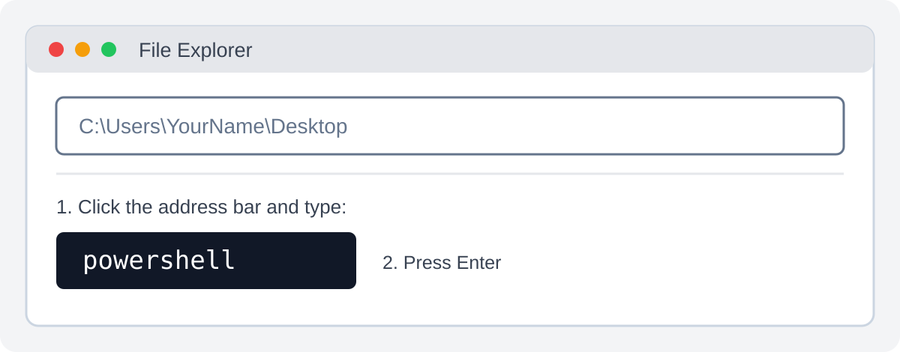

# SkillBridge AI

SkillBridge AI is a student-focused platform designed to help users discover opportunities, build their professional profiles, and track their career development.

## Main Modules

The project is organised into five main modules:

1. **AI Resume Builder** — create and improve resumes.
2. **Portfolio Generator** — generate a portfolio to showcase skills and achievements.
3. **Opportunity Portal** — discover opportunities such as internships, micro-internships, hackathons and events.
4. **AI Opportunity & Skill Gap Analyzer** — compare a user's skills with opportunity or career requirements.
5. **Application Tracker** — manage applications and track their progress.

## Technology Stack

- **Frontend:** Next.js
- **Language:** TypeScript
- **Package manager:** npm
- **Database and backend services:** Supabase
- **Database:** PostgreSQL

## Getting Started

### Prerequisites

Install the following before setting up the project:

- [Node.js (LTS)](https://nodejs.org/)
- [Git](https://git-scm.com/)
- [Visual Studio Code](https://code.visualstudio.com/)

### Installation

Follow these steps to download and set up SkillBridge AI on your computer.

#### Step 1: Choose a location for the project

First, decide where you want to store the project, such as:

- `C:\Users\YourName\Desktop`
- `C:\Users\YourName\Documents`
- `D:\Projects`

**Tip: Open PowerShell directly inside a folder**

You do not need to navigate through folders manually using PowerShell commands.

1. Open File Explorer.
2. Navigate to the folder where you want to store the project (for example, Desktop).
3. Click the address bar at the top of File Explorer.
4. Type `powershell` and press Enter.

PowerShell will open directly at that folder's location. You can also type `cmd` to open Command Prompt instead.



#### Step 2: Clone the GitHub repository

In the PowerShell window, run:

```powershell
git clone https://github.com/Faqih619/workshop2.git
```

This downloads the project into a new folder named `workshop2`.

Move into the project directory:

```powershell
cd workshop2
```

**Important:** Run `git clone` from the parent folder where you want the project directory to be created. Do not run it inside an existing `workshop2` folder.

#### Step 3: Run the setup script (Windows)

Make sure your PowerShell terminal is inside the `workshop2` project directory.

Run:

```powershell
.\setup.bat
```

The script will automatically:

- Check whether Git, Node.js and npm are installed.
- Create `.env.local` using `.env.example` if it does not already exist.
- Install the required project dependencies using `npm install`.

If Git or Node.js is missing, install it first:

- [Git](https://git-scm.com/downloads)
- [Node.js (LTS)](https://nodejs.org/)

The setup script does not overwrite an existing `.env.local` file.

#### Step 4: Start the development server

After setup completes, run:

```powershell
npm run dev
```

Open your browser and visit:

[http://localhost:3000](http://localhost:3000)

You should now see the SkillBridge AI application running locally.

#### Alternative: Manual installation

If you prefer not to use the setup script, or if you are not using Windows, run:

```bash
npm install
```

Then create your own `.env.local` file in the project root using the configuration below.

### Environment Configuration

Create a `.env.local` file in the project root and add the shared SkillBridge AI Supabase configuration:

```env
NEXT_PUBLIC_SUPABASE_URL=https://uccyqmearvavwyvfvmyc.supabase.co
NEXT_PUBLIC_SUPABASE_ANON_KEY=sb_publishable_zXhzmMuRbgVCii7NJjwAWQ_pPZ0nd_c
```

All team members use the same Project URL and Publishable Key, but each person must have their own local `.env.local` file. On Windows, `setup.bat` copies these values from `.env.example` automatically when `.env.local` is missing.

The variable name `NEXT_PUBLIC_SUPABASE_ANON_KEY` is retained for compatibility with the current project code; its value is the Supabase Publishable Key.

The Publishable Key is intended for client-side applications. Never expose or commit a Supabase Secret Key (such as an `sb_secret_...` key). Keep Row Level Security (RLS) enabled and configure appropriate policies before storing real user data. Never commit `.env.local` to Git.

See [Environment Setup](docs/03-environment-setup.md) for details.

### Run the Development Server

```bash
npm run dev
```

Open [http://localhost:3000](http://localhost:3000) in your browser.

## Documentation

Read the guides in the `docs/` directory before starting development:

| Guide | Description |
|---|---|
| [Installation Guide](docs/01-installation-guide.md) | Install the tools and run the project locally |
| [Git & GitHub Guide](docs/02-git-guide.md) | Common Git commands and collaboration workflow |
| [Environment Setup](docs/03-environment-setup.md) | Configure local environment variables |
| [Supabase Guide](docs/04-supabase-guide.md) | Understand the shared Supabase project |
| [Project Structure](docs/05-project-structure.md) | Understand the main directories and files |
| [Database Migrations](docs/06-database-migrations.md) | Create, review and apply database migrations |
| [Troubleshooting](docs/07-troubleshooting.md) | Resolve common development issues |

See [CONTRIBUTING.md](CONTRIBUTING.md) for branch naming, commit messages, pull requests and team contribution rules.

## Development Workflow

- Keep `main` stable; do not push directly to it.
- Create a feature branch for your assigned module or task.
- Pull the latest `main` before starting work.
- Commit changes with clear messages.
- Push your branch and open a Pull Request targeting `main`.
- Coordinate changes to shared components and the shared Supabase database with the team.

## Useful Commands

| Command | Purpose |
|---|---|
| `npm install` | Install project dependencies |
| `npm run dev` | Start the development server |
| `npm run build` | Create a production build |
| `npm run lint` | Run the project's lint script, if configured |
| `git status` | Check working tree changes |
| `git pull origin main` | Update the local main branch |

## Deployment

Deployment instructions will be added when the production hosting setup is finalised. For general Next.js deployment information, see the [Next.js deployment documentation](https://nextjs.org/docs/app/building-your-application/deploying).
